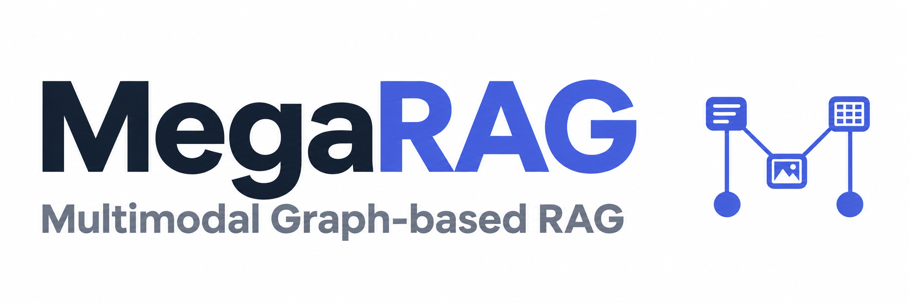

<p align="center">
  
</p>

<p align="center">
  <a href="https://aclanthology.org/2026.acl-long.2218/"></a>
  <a href="LICENSE"></a>
</p>

> ✨ **Update (2026-11-02):** Simpler setup and configurable LLM APIs. [Quickstart](#quickstart) · [API examples](docs/models.md)

Multimodal graph-based retrieval for document question answering. MegaRAG combines a knowledge graph with page-image retrieval to answer questions across text, figures, and tables.

[Paper](https://aclanthology.org/2026.acl-long.2218/) · [Model configuration](docs/models.md) · [MinerU workflow](docs/mineru.md) · [Troubleshooting](docs/troubleshooting.md)

<a id="install"></a>

## 📦 Install

Use Python 3.10–3.12; Python 3.11 is recommended. The default setup uses a local GME embedding model and a vision-capable OpenAI API model. A CUDA GPU is recommended for embedding inference; CPU execution is supported but slower.

```bash
git clone https://github.com/AI-Application-and-Integration-Lab/MegaRAG.git
cd MegaRAG
python3.11 -m venv .venv
source .venv/bin/activate
pip install -e ".[local,pdf]"
export OPENAI_API_KEY="your-api-key"
```

LightRAG is installed automatically. On Windows, activate the environment with `.venv\Scripts\Activate.ps1` and set the key with `$env:OPENAI_API_KEY="your-api-key"`.

Install MinerU in a separate environment for PDF parsing:

```bash
python3.11 -m venv .venv-mineru
.venv-mineru/bin/python -m pip install -r requirements_mineru.txt 'mineru[torch]==4.1.3'
export MINERU_PYTHON="$PWD/.venv-mineru/bin/python"
```

See [MinerU setup](docs/mineru.md#install-separately) for GPU requirements and Windows commands.

<a id="quickstart"></a>

## 🚀 Quickstart

Create a configuration, index your PDF, and ask a question. Replace `./report.pdf` with the path to your document:

```bash
megarag init
megarag ingest ./report.pdf --config megarag.yaml --workspace ./report-index
megarag query "What are the main findings?" --config megarag.yaml --workspace ./report-index
```

Every PDF goes through **MinerU → graph construction → indexing** automatically. The first ingestion downloads parser and embedding models and makes LLM API calls. To use another LLM provider, see [model configuration](docs/models.md) before indexing.

### Try different documents

Follow the [document examples](docs/examples.md) with five included **two-page PDFs**: a research paper, financial report, user manual, product brochure, and image-only presentation. Each has matching entity types, a ready-to-use configuration, and commands to build a graph, ask a question, and check the answer. Swap in your own PDF to use the same workflow.

<a id="use-your-own-pdf"></a>

## 📄 PDF tips

Add `--max-pages 3` to try a few pages first. Use a fresh workspace when moving from a page-limited trial to the full document, or when replacing an existing PDF.

MinerU handles text PDFs, scanned pages, tables, and figures using the same command. Parsed assets stay inside the workspace and are reused on retries. See the [MinerU workflow](docs/mineru.md) for advanced parsing options. Rebuild indexes created before this automatic MinerU workflow in a new workspace.

## Run a question file

Put one question per line in `questions.txt`, including questions in Chinese or other languages:

```text
What are the main findings?
What evidence supports these findings?
```

```bash
megarag query --questions questions.txt --output answers.jsonl --config megarag.yaml --workspace ./report-index
```

Each completed answer is saved immediately. JSONL input with `{"question": "..."}` is also supported. Output files are not overwritten.

<a id="configure-models"></a>

## ⚙️ Configure models

Edit `megarag.yaml` to set the language model, API endpoint, embedding device, or batch size. Pass the same configuration to ingestion and querying.

```yaml
llm:
  model: gpt-4o-mini
  base_url: https://api.openai.com/v1
  api_key_env: OPENAI_API_KEY
embedding:
  model: Alibaba-NLP/gme-Qwen2-VL-2B-Instruct
  dimension: 1536
  device: auto
  batch_size: 2
```

See [model configuration](docs/models.md) for OpenAI, OpenRouter, SGLang, and vLLM examples and compatibility rules. Changing the model requires a new workspace; an existing index is never silently reused with a different configuration.

## Development

```bash
pip install -e ".[pdf,dev]"
python -m pytest
python -m build
```

Tests use model and API substitutes; they do not download model weights or incur API charges. See [validation](docs/validation.md) for the scope of these checks.

## Citation

```bibtex
@inproceedings{hsiao2026megarag,
  title={MegaRAG: Multimodal Graph-based Retrieval Augmented Generation},
  author={Hsiao, Chi-Hsiang and Wang, Yi-Cheng and Lin, Tzung-Sheng and Yeh, Yi-Ren and Chen, Chu-Song},
  booktitle={Proceedings of the 64th Annual Meeting of the Association for Computational Linguistics (ACL)},
  year={2026},
  url={https://aclanthology.org/2026.acl-long.2218/}
}
```

## License

MegaRAG uses a [custom license](LICENSE). For academic or commercial use, contact the authors as described in the license.

<a id="acknowledgments"></a>

## 🙏 Acknowledgments

Built on [LightRAG](https://github.com/HKUDS/LightRAG), with document parsing support through [MinerU](https://github.com/opendatalab/MinerU).
